# Chess

In my perspective, Chess belongs to those games called : `Strategic & Analytic Game`.

Chess is a known board game that has $8 \times 8$ dimensions. It's regularly played by two players but it has some variants that can be played by more than $2$ players. In case of two player, there is two sides : **White pieces** and **Black pieces**. In the beginning, each players have $16$ pieces on the board [*if counted distinctly by type, each side have $6$ pieces*]. The player who plays with the white pieces begin the game. So, often strong players who played this games about decade call this `having the initiative on the game`.

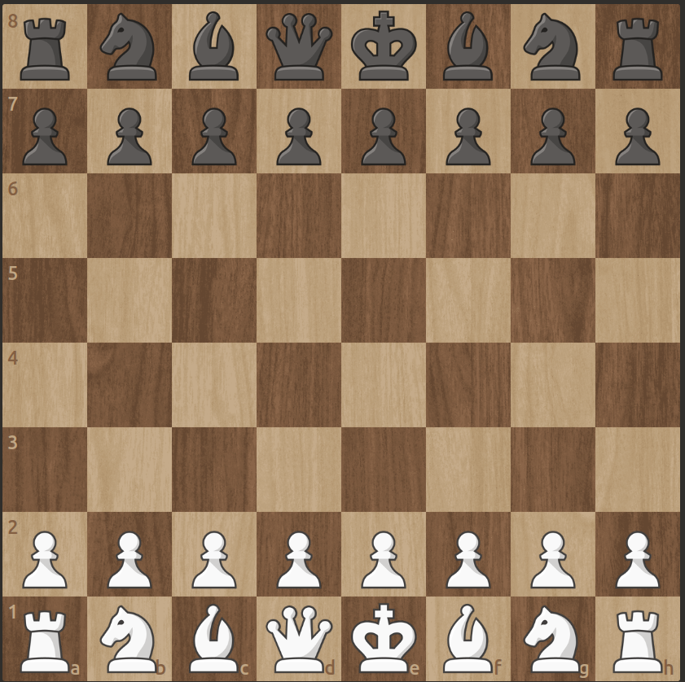

## Chess Pieces

A chess piece move differently from the others, so each pieces have a set of move that they can do. Here are the differents names and their authorized moves [*only a knight can jump over other chess pieces so the move below is according to they haven't no obstruction in their passage*] :

- **King** [*notation : K*] : a king can move only one square from the square where he started but in every directions.

    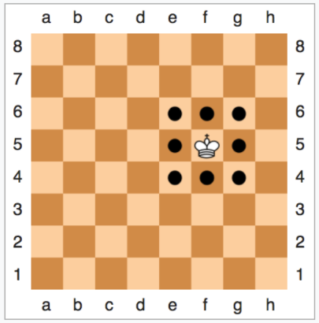

- **Queen** [*notation : Q*] : a Queen can move everywhere on the chessboard if only if there is no other piece from her side that obstruct the case and the king is not in check [*under attack*].

    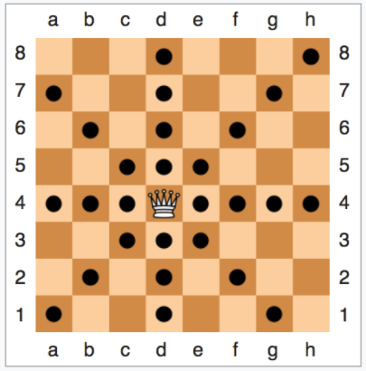

- **Rook** [*notation : R*] : a rook can move forward, backward, left or right as many squares possible. Like the Queen move it can be possible if when you play it the two conditions above are not true.

    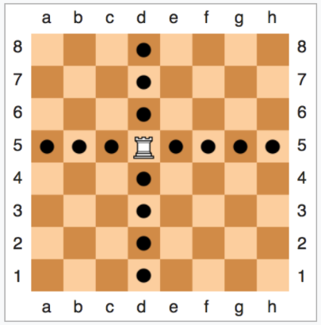

- **Bishop** [*notation : B*] : a bishop can move diagonally according to the case color when it was started to be play. The two conditions before need to be false, then it can move freely on the diagonal.

    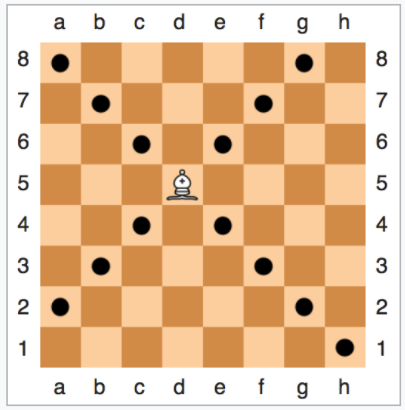

- **Knight** [*notation : N*] : a knight can move two squares in one direction then one square to side, forming a L-shape.

    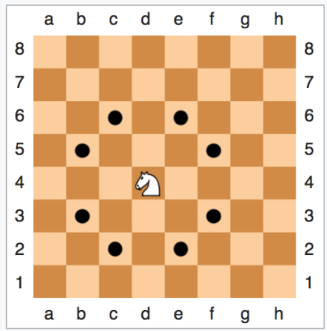

- **Pawn** [*notation : according to the column&row notation*] : a pawn can move two squares on its first move. Then, only one move forward [if you push a pawn to one square it can't move two square after your move]. Philidor said : **Pawn is the soul of chess game**.

    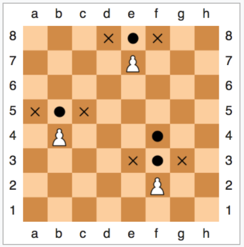

## Phase of Chess Game

In a game of chess we can denote three parts that establish through the move of both player :

- **Opening** : the opening is where the two players will play a sequence of move that already have been studied. So, these move composed nowadays a sort of knowledge called **Opening theory**. It can be done with very brief or very long sequence of move according to the level of memorization for each side. A GrandMaster can played perfectly more than $20$ moves in a theoric line. A player style can be defined from their opening choices.

- **Middle Game** : when the opening phase is finished the two players will play in the middle game. According to the style chosen by both side this middle game can be **chaotic** or **very stable** position. This phase is about exchanging pieces, positionning them and often preparing the endgame.

- **Endgame** : the game enters the endgame phase when a significant number of pieces have been traded off (typically characterized by the absence of queens, or when few pieces remain on the board). In this phase, pawn promotion becomes critical, King activity is paramount, and precision is required to convert an advantage into a win.

## Chess Time Controls

In Over-The-Board (OTB) and online chess, clocks are used to limit the time each player has to think and make their moves. There are different categories of time controls depending on how fast the game is played :

- `Classical` : traditional tournament games where players have hours to think, often with an added amount of time (an increment) after every move to allow for deep calculation in complex positions. In the world championship, the time control is about $2$ hours and have $40$ minutes increment on the $40^{th}$ moves.

- `Rapid` : each player have less that $30$ minutes. But it has some variant like : $10+0$ [each player have 10 minutes with 0 increment on the clock], $15+10$ [each player have 15 minutes with 10 seconds increment by move],$\ldots$

- `Blitz` : where each player usually has between $3 \leq t < 10$ minutes (for example, $3$ minutes or $5$ minutes per game). There is some variants : $3+0$ [each player have only 3 minutes], $5+0$ [each player have only 5 minute, this is the Title Tuesday format].

- `Bullet` : ultra-fast games where each player has less than $3$ minutes total (for example, $1$ minute or $2$ minutes with $1$ second added per move).

## Chess Rules

In official tournament, **FIDE** [Fédération Internationale Des Echecs] has emitted some rules that each players have to respect (https://www.fide.com/FIDE/handbook/LawsOfChess.pdf).

But if you want just to play chess for fun on online platform, you need to know some basic rules :

- The game of chess is played between two opponents who move their pieces alternately on a square board called a `chessboard`. The player with the white pieces commences the game.

- The objective of each player is to place the opponent’s king `under attack` in such a way that the opponent has no legal move. The player who achieves this goal is said to have `checkmated` the opponent’s king and to have won the game. Leaving one’s own king under attack, exposing one’s own king to attack and also `capturing` the opponent’s king are not allowed. The opponent whose king has been checkmated has lost the game.

- It is not permitted to move a piece to a square occupied by a piece of the same colour. If a piece moves to a square occupied by an opponent’s piece the latter is captured and removed from the chessboard as part of the same move. A piece is said to attack an opponent’s piece if the piece could make a capture on that square

- The game is won by the player who has checkmated his opponent’s king. This immediately ends the game, provided that the move producing the checkmate position was a legal move.The game is won by the player whose opponent declares he resigns. This immediately ends the game

## Buzzwords

Chess has some vocabs has its own specific vocabulary :

- **Checkmate** : a situation where the king is under attack [opponent pieces atatcked the square where the king was] and it has no legal move [all the square that he can move are controlled by one or more pieces]. This is the **graal** because when you mate the king, you win the game. But there is a warning : `When you come at the king, you best not miss`. 

    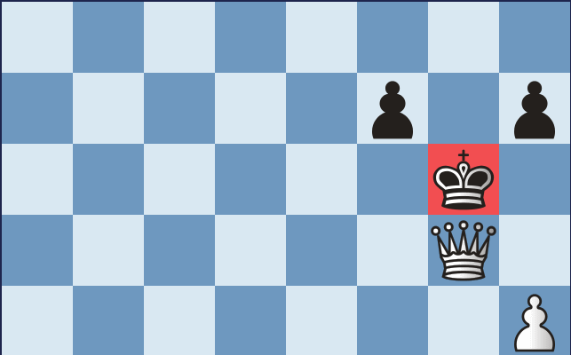

- **Stalemate** : a draw that happens when a player whose turn it is to move has no legal moves left, and their king is not in check.

    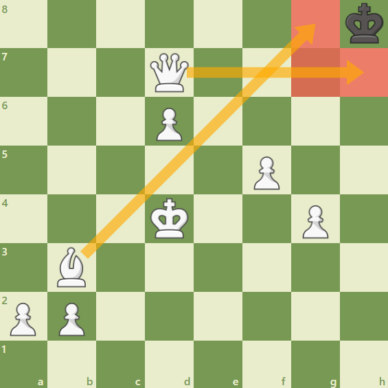

- **Castling** : This is a move of the king and either rook of the same colour along the player’s first rank, counting as a single move of the king and executed as follows : the king is transferred from its original square two squares towards the rook on its original square, then that rook is transferred to the square the king has
just crossed.

    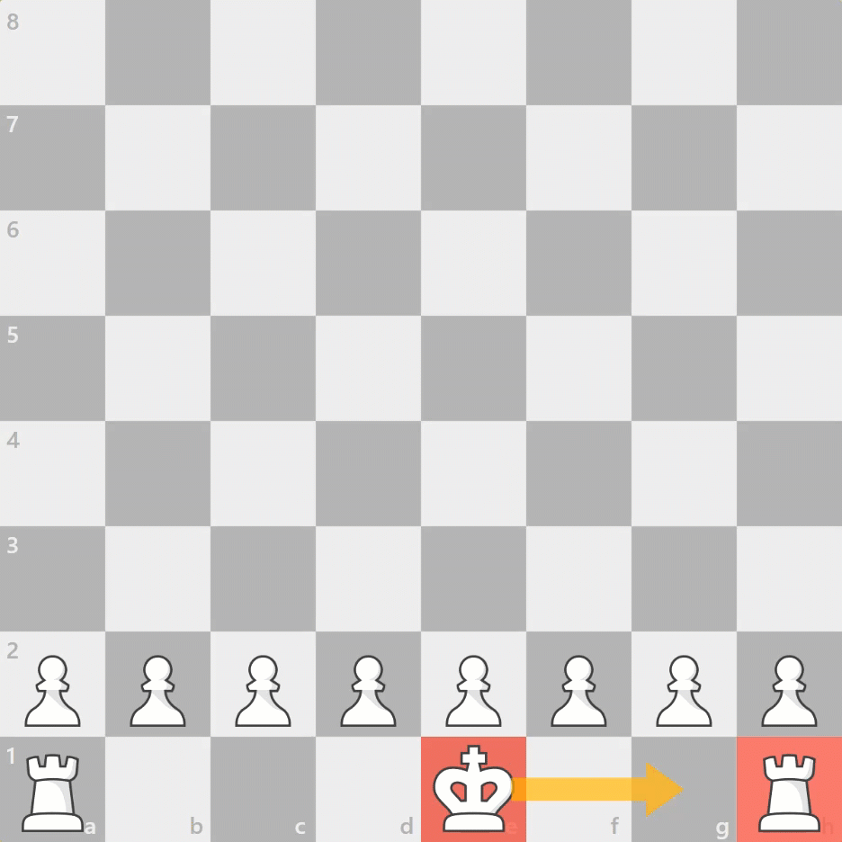

- **Zugzwang** : a situation where any move you make will make your position worse, because you are forced to play even when you don't want to.

- **En passant** : a special pawn capture rule in chess where a pawn captures an enemy pawn that has just moved two squares forward from its starting position.

    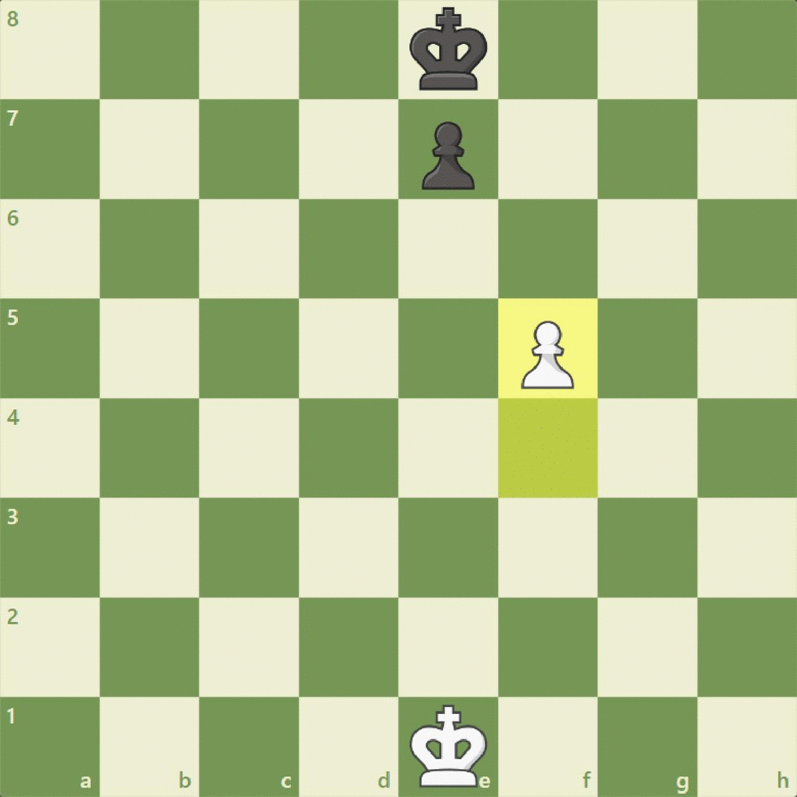

- **Pin** : when a piece cannot move because it would expose a more valuable piece (like the King or Queen) behind it to an attack.

    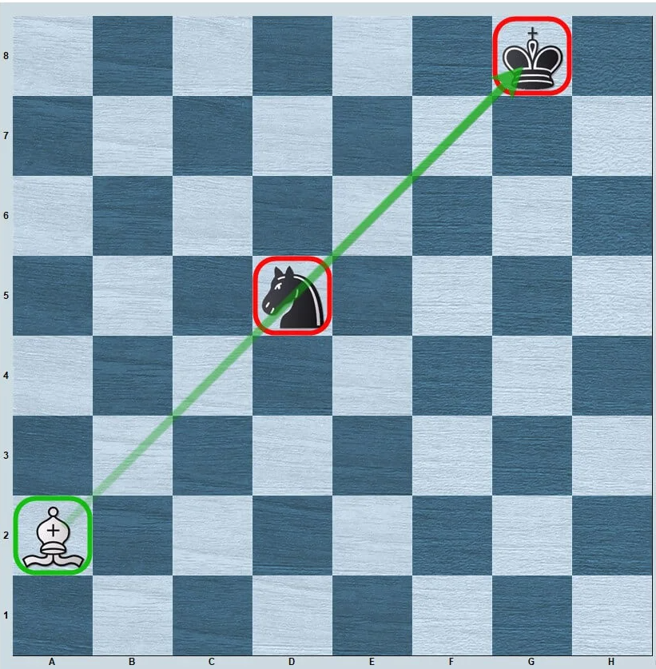

- **Fianchetto** : developing a bishop to the long diagonal by moving the knight's pawn forward one square.

    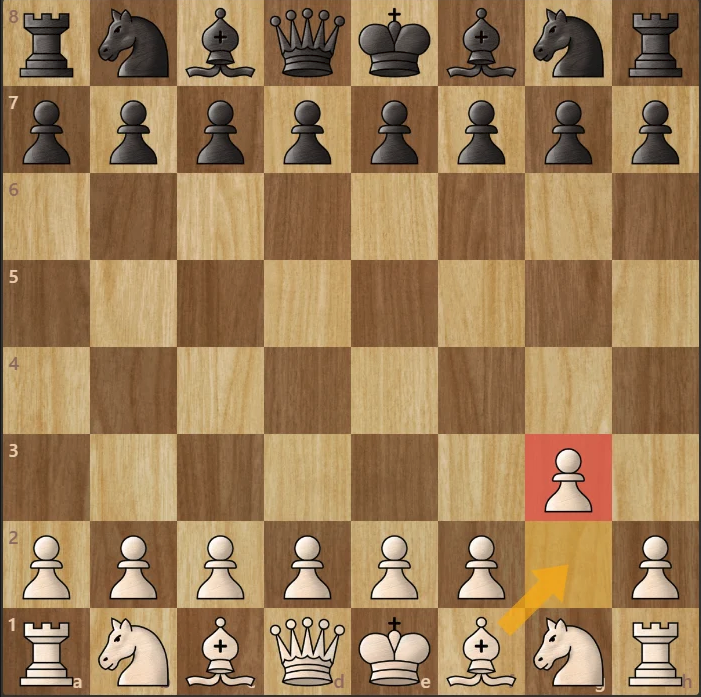

- **Fork** : when one piece (often a knight or pawn) attacks two or more enemy pieces at the same time. The most dangerous one is the royal fork, it's when a knight or a protected pawn attacked simultaneously the king and queen [so the player who attacked can win a queen].

    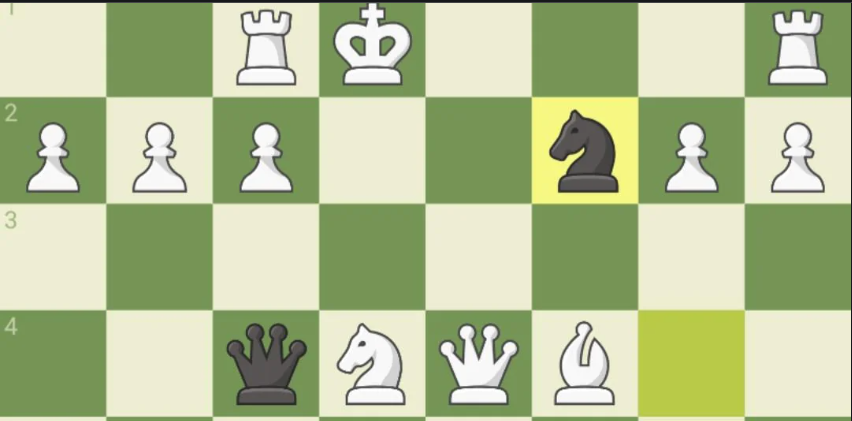

- **Gambit** : an opening where a player sacrifices a pawn or piece early in the game to get a faster attack or a better position. On late $2020$ was released the  **Queen Gambit, Netflix series**, which is make a reference on a known opening that sacrified temporarily the pawn in `c4`.

    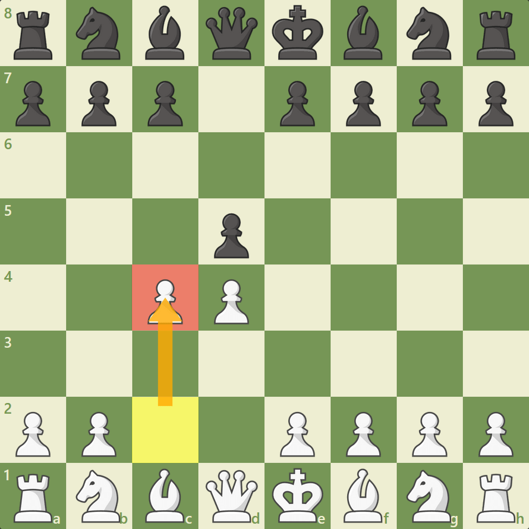

## Player Type

Chess players can be described by their preferred way of solving positions. These labels are useful for analysis and training, but they are **descriptive tendencies rather than formal, mutually exclusive categories**. A player may be positional in quiet positions, tactical when combinations appear, and defensive when under pressure.

There is many player style out there but we only focus on these two examples :

- **Positional Player** : A positional player aims to build and exploit long-term advantages, often without needing an immediate tactical win.

    - **Main focus** : Pawn structure, weak squares, piece activity, space, outposts, and long-term targets.

    - **Approach** : Improve the least active piece, restrict the opponent, create weaknesses, and increase pressure gradually.

    - **Strengths** : Strategic planning, prophylaxis, maneuvering, and converting small advantages.

- **Tactical Player** : A tactical player is especially alert to concrete sequences that can change the evaluation of a position quickly.

    - **Main focus** : Forcing moves, combinations, forks, pins, skewers, discovered attacks, deflections, and sacrifices.

    - **Typical approach** : Calculate checks, captures, and threats; compare candidate lines; and look for tactical vulnerabilities.

    - **Strengths** : Calculation, tactical awareness, and exploiting inaccuracies.
