# Chess

In my perspective, chess belongs to the family of `strategic and analytic games`.

Chess is played on an $8 \times 8$ board. The standard game has two players, though some variants are played by more. The two sides are **White** and **Black**. At the start each side has $16$ pieces: one king, one queen, two rooks, two bishops, two knights and eight pawns, so $6$ distinct piece types. White moves first. That small head start is called the **first-move advantage**. It is not the same thing as the *initiative*, which is the ability to make threats the opponent must answer, and which either side can hold or lose during a game.

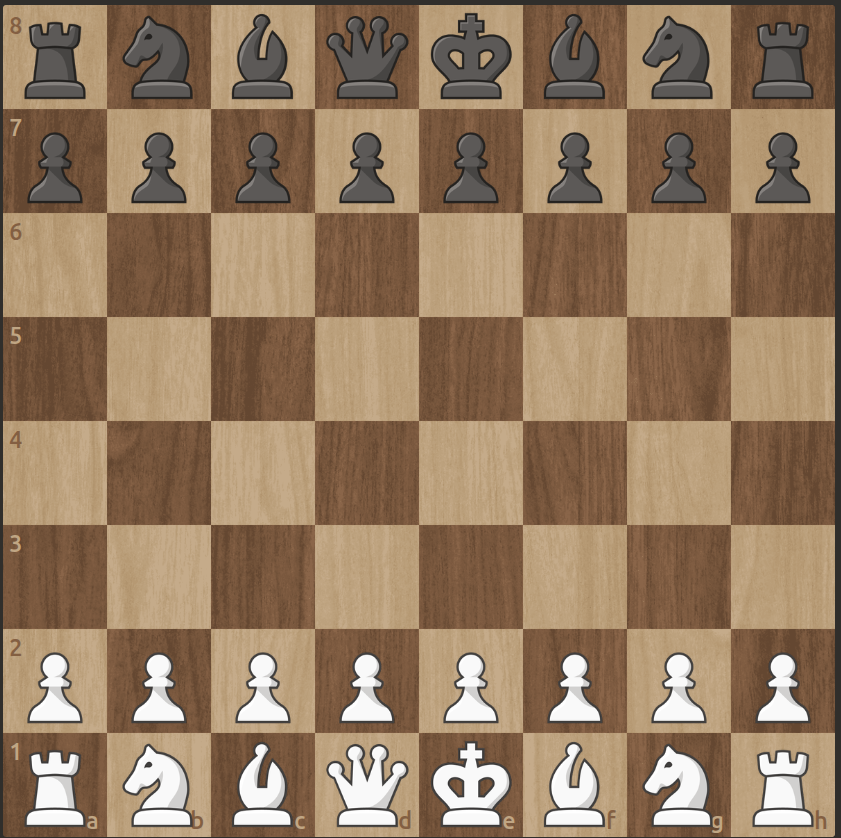

## Chess Pieces

Each piece moves in its own way. Only the knight can jump over other pieces. Every other piece stops at the first occupied square on its path: it can capture an enemy piece standing there, but it can never move onto or through a square held by its own side. No move is legal if it leaves your own king in check.

- **King** [*notation: K*]: moves one square in any direction. Once per game it may castle (see Castling below). It may never move to a square attacked by the opponent.

    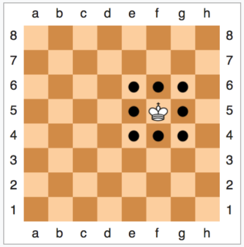

- **Queen** [*notation: Q*]: moves any number of squares along a rank, a file or a diagonal, combining the rook and the bishop. Any piece in the way blocks her. She may capture the first enemy piece on her line.

    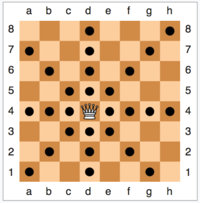

- **Rook** [*notation: R*]: moves any number of squares along a rank or a file (forward, backward, left or right), under the same blocking and capture rules as the queen.

    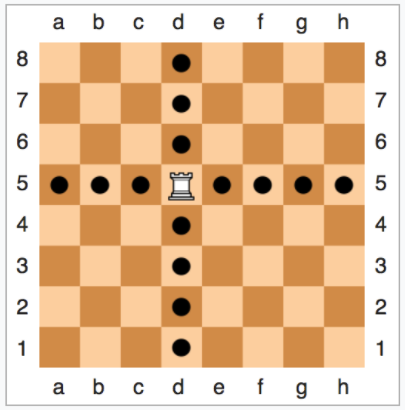

- **Bishop** [*notation: B*]: moves any number of squares diagonally, under the same rules. A bishop stays on the square colour it starts on for the whole game.

    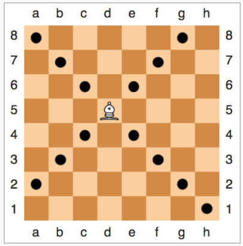

- **Knight** [*notation: N*]: moves two squares in one direction, then one square to the side, forming an L-shape. It jumps over any piece in between.

    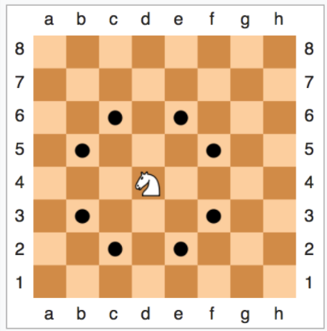

- **Pawn** [*notation: only the destination square, e.g. `e4`; a capture names the file it left, e.g. `exd5`*]: moves one square straight forward onto an empty square. On its first move it *may* advance two squares if both are empty. It captures one square diagonally forward, never straight ahead. It can also capture *en passant* (see below). A pawn that reaches the last rank must promote to a queen, rook, bishop or knight. Philidor said: **"Pawns are the soul of chess."**

    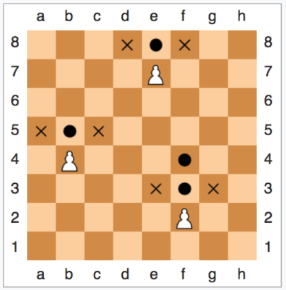

## Phase of Chess Game

A game of chess goes through three phases:

- **Opening**: both players follow sequences that have already been studied. Together these sequences form **opening theory**. A line can be short or long, depending on how much each side has memorised. A grandmaster can play more than $20$ moves of a main theoretical line from memory. A player's style often shows in their opening choices.

- **Middlegame**: after the opening, the players enter the middlegame. Depending on the styles of both sides, it can be **sharp and tactical** or **quiet and positional**. This phase is about plans, piece placement, attacks and the exchanges that shape the coming endgame.

- **Endgame**: the game enters the endgame once most pieces have been traded. There is no single official threshold. Common working definitions are "the queens are off and only a few minor or major pieces remain", or a small total of non-pawn material. In this phase pawn promotion becomes central, the king becomes an active piece, and precision is needed to convert an advantage.

## Chess Time Controls

Over-the-board and online, clocks limit the time each player has for their moves. Time controls are written `minutes+increment`, where the increment is in seconds added after each move.

- `Classical`: tournament games with hours per player, usually with an increment or a second time period. The World Championship match uses $120$ minutes for the first $40$ moves, then $30$ more minutes for the rest of the game, with a $30$-second increment from move $41$.

- `Rapid`: FIDE rapid gives each player more than $10$ and less than $60$ minutes. Chess.com counts any game with $10$ minutes or more per player (and under one day) as rapid. Common examples are $10+0$ and $15+10$ (15 minutes plus 10 seconds per move).

- `Blitz`: on Chess.com, from $3$ to under $10$ minutes per player, for example $3+0$, $3+2$ or $5+0$. FIDE blitz is $10$ minutes or less. **Titled Tuesday**, Chess.com's weekly titled-player event, is played at $3+1$.

- `Bullet`: under $3$ minutes per player, for example $1+0$ or $2+1$.

- `Daily`: correspondence chess, with days per move. Chess.com PGN headers write it as `1/86400`, one move per $86400$ seconds.

## Chess Rules

In official tournaments the **FIDE** (Fédération Internationale des Échecs) Laws of Chess apply (https://handbook.fide.com/chapter/E012023).

To play casually online, these basic rules are enough:

- The game is played between two opponents who move their pieces alternately on a square board called a `chessboard`. The player with the white pieces starts.

- Each player tries to place the opponent's king `under attack` so that the opponent has no legal move. That is `checkmate`, and it wins the game. You may not leave or place your own king under attack, and the king is never captured.

- A piece may not move to a square occupied by a piece of its own colour. If a piece moves to a square occupied by an opponent's piece, that piece is captured and removed as part of the same move. A piece attacks a square if it could capture on that square.

- The game is won by checkmate, which ends it immediately provided the mating move was legal. It is also won when the opponent resigns or runs out of time (if the winner still has mating material). It is drawn by stalemate, agreement, threefold repetition, the fifty-move rule, or insufficient material.

## Buzzwords

Chess has its own vocabulary:

- **Checkmate**: the king is in check (attacked) and the side to move has **no legal move** to escape. There are three ways out of check, and none works here: moving the king, capturing the checking piece, or blocking the line of attack. Checkmate wins the game immediately. As the saying goes: `When you come at the king, you best not miss`.

    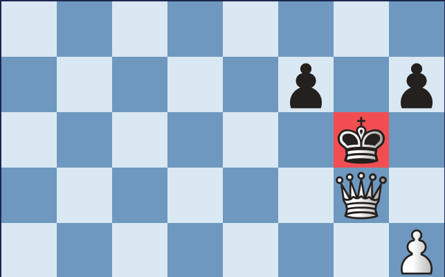

- **Stalemate**: a draw. The player to move has no legal move, and their king is not in check.

    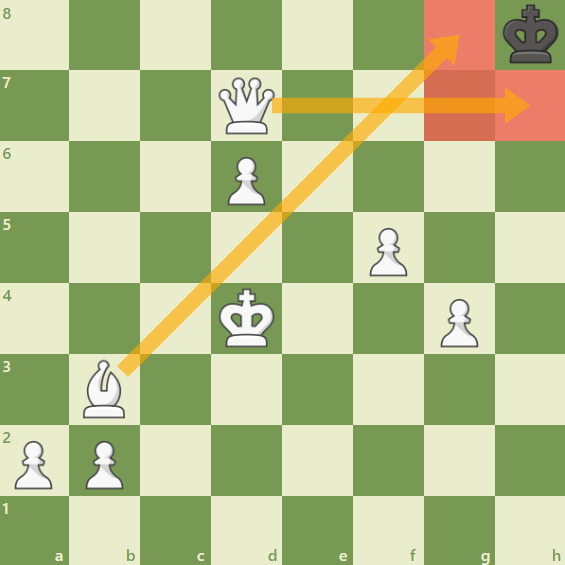

- **Castling**: a move of the king and one rook of the same colour along the first rank, counted as a single king move. The king moves two squares towards the rook, then the rook jumps to the square the king just crossed. Castling is not allowed if the king or that rook has already moved, if a square between them is occupied, if the king is in check, or if the king would pass through or land on an attacked square.

    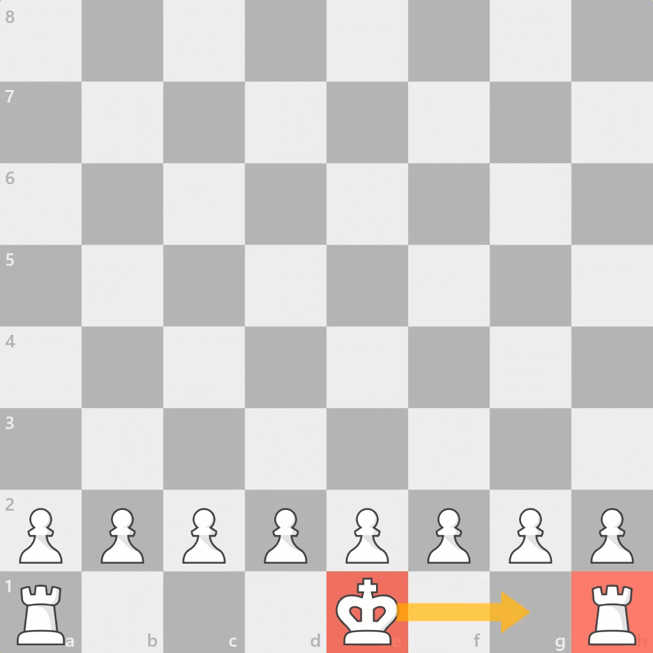

- **Zugzwang**: a position where any move you make worsens your position, but you must move because passing is not allowed.

- **En passant**: when a pawn advances two squares and lands beside an enemy pawn, that enemy pawn may capture it as if it had moved only one square. This is allowed only on the very next move.

    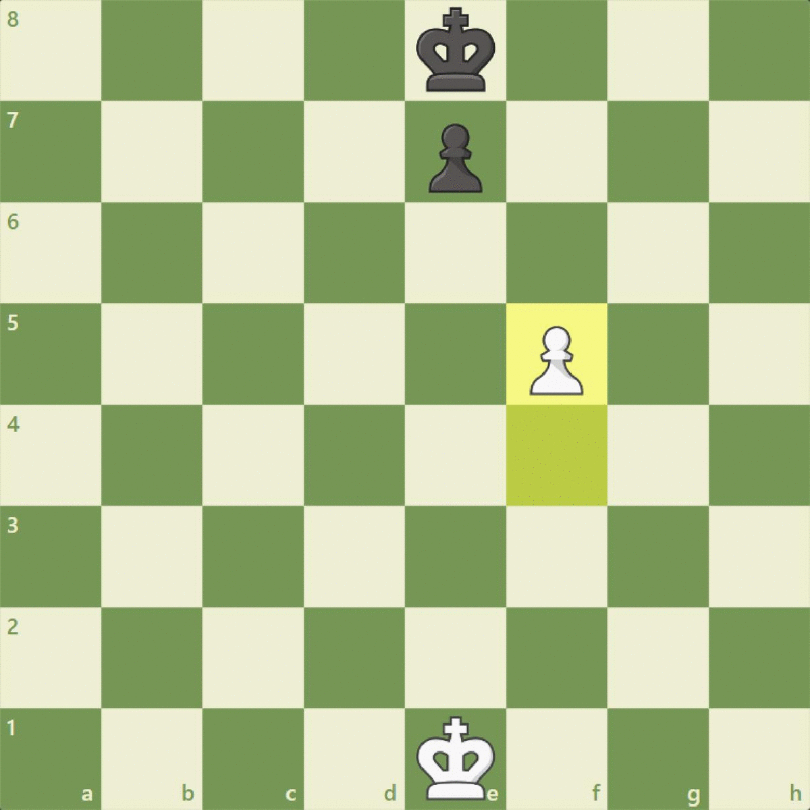

- **Pin**: a piece is pinned when moving it would expose a more valuable piece behind it.
    - An **absolute pin** is a pin against the king. The pinned piece cannot legally leave the line.
    - A **relative pin** is a pin against anything else, such as the queen. Moving the pinned piece is legal, just usually costly.

    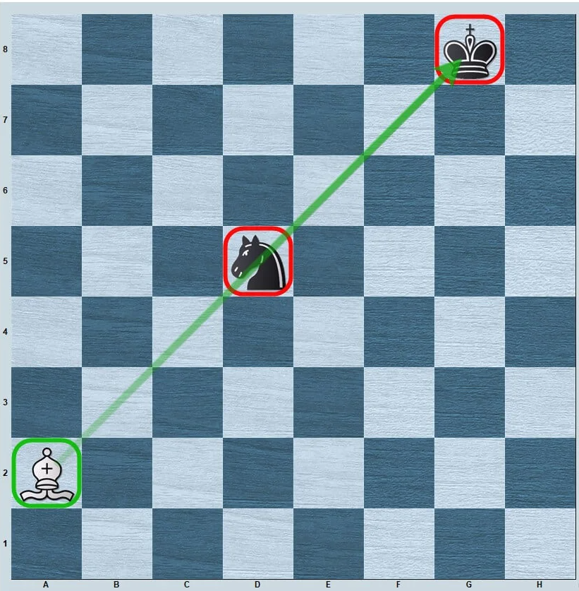

- **Fianchetto**: developing a bishop to the long diagonal by advancing the knight's pawn one square (g3/b3 for White, g6/b6 for Black).

    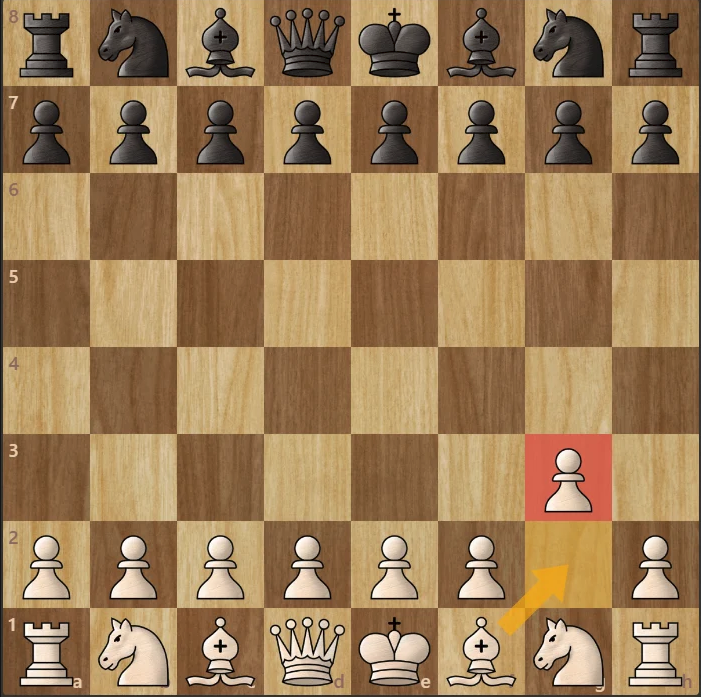

- **Fork**: one piece, often a knight or a pawn, attacks two or more enemy pieces at once. A **royal fork** is a knight attacking the king and the queen together. The king must move, and the queen falls.

    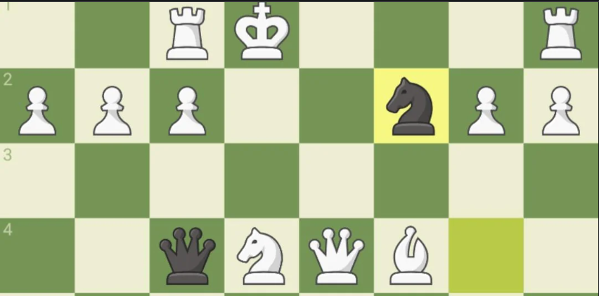

- **Gambit**: an opening where a player offers material, usually a pawn, for faster development, the centre or an attack.
    - The **Queen's Gambit** (1.d4 d5 2.c4) offers the c4 pawn. Black usually cannot keep it, so it is a gambit in name only.
    - The Netflix series **The Queen's Gambit** (October $2020$) is named after it.

    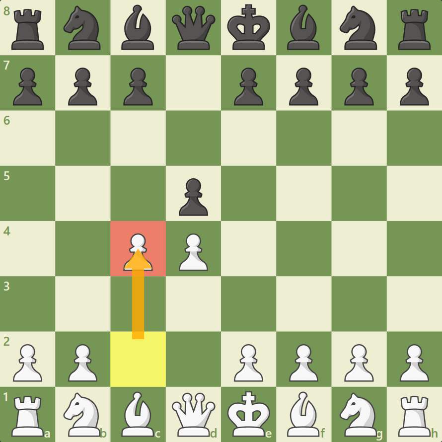

## Player Type

Chess players can be described by the way they prefer to solve positions. These labels help with analysis and training, but they describe **tendencies, not formal or exclusive categories**. A player may be positional in quiet positions, tactical when combinations appear, and defensive under pressure.

There are many playing styles; we focus on two:

- **Positional Player**: builds and exploits long-term advantages, often without needing an immediate tactical win.

    - **Main focus**: pawn structure, weak squares, piece activity, space, outposts, and long-term targets.

    - **Approach**: improve the least active piece, restrict the opponent, create weaknesses, and increase pressure gradually.

    - **Strengths**: strategic planning, prophylaxis, maneuvering, and converting small advantages.

- **Tactical Player**: especially alert to concrete sequences that can change the evaluation quickly.

    - **Main focus**: forcing moves, combinations, forks, pins, skewers, discovered attacks, deflections, and sacrifices.

    - **Typical approach**: calculate checks, captures, and threats; compare candidate lines; look for tactical vulnerabilities.

    - **Strengths**: calculation, tactical awareness, and exploiting inaccuracies.
