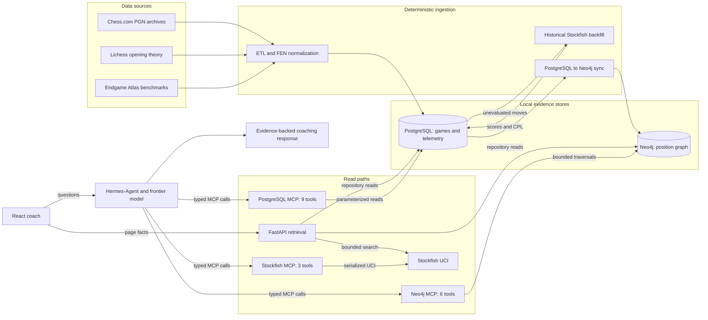
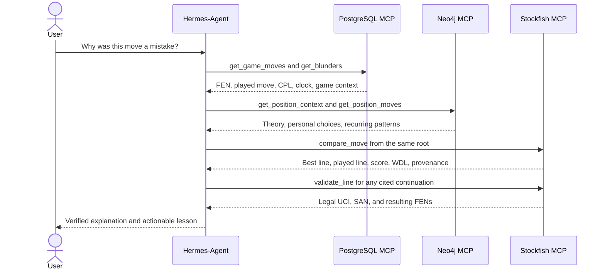

<div align="center">

# ChessGraph MCP

### A local layer for personalized chess coaching

Connect an MCP-capable agent to personal game history, a positional knowledge
graph, and reproducible Stockfish analysis—without giving the model unrestricted
database access.

[](https://www.python.org/)
[](https://modelcontextprotocol.io/)
[](https://stockfishchess.org/)
[](LICENSE)

**Deterministic analysis · Personal evidence · Typed MCP tools · Read-only by design**

</div>

---

## Why ChessGraph?

A chess engine can calculate excellent moves, but it does not know your history.
A database can reveal recurring mistakes, but it cannot calculate the best move
in a new position. A language model can explain ideas, but it should not invent
the chess evidence behind them.

ChessGraph MCP separates those responsibilities:

- **Stockfish calculates** candidate moves, evaluations, WDL, and principal variations.

- **PostgreSQL remembers** games, move telemetry, openings, endgames, and historical engine evaluations.

- **Neo4j connects** positions, personal moves, theory moves, transpositions, games, and endgame patterns.

- **The retrieval API serves** those same reads to the interface, without asking the model to fetch the page.

- **Hermes-Agent explains** the combined evidence as a personalized lesson.

> The design principle is simple: **the engine searches, deterministic code
> validates, the databases provide context, and the model explains only the
> evidence it receives.**

## Architecture



The ETL layer writes data. The MCP servers and the retrieval API only read.
They call the same repositories in `chess_mcp/`. MCP tools stay typed and
bounded for Hermes. The API serves the facts the interface can draw before a
question is asked, such as the rating-band recap and the ranked training plan.
Hermes explains; it does not assemble the page.

## What the agent can ask

| Evidence source | Best suited for | MCP capabilities |
| --- | --- | --- |
| PostgreSQL | Game selection, longitudinal statistics, move records, openings, endgames, ranked coaching briefs | 9 curated tools, paginated move retrieval, statement timeouts |
| Neo4j | Theory versus personal choices, transpositions, recurring positions, graph context | 6 curated tools, anchored queries, maximum traversal depth |
| Stockfish | Fresh position analysis, candidate comparison, WDL, legal variations | MultiPV, same-root move comparison, line validation |

Examples:

- “Show my largest rapid-game mistakes and explain the top three.”

- “Where did I leave opening theory, and what did I usually play instead?”

- “Do different move orders in my games transpose into this position?”

- “Compare my move with Stockfish's best move using the same search budget.”

- “Which opening family scores worst for me, and what should I drill first?”

- “Which positions keep tempting me into the same wrong move?”

- “Which endgame patterns recur in my losses?”

## Evidence flow for a coaching answer



## Personalized training

The training view is not a fixed lesson list. Both API endpoints behind it read
the stored games and rank what to work on next.

`GET /api/coach/brief` returns the material a coach would open with:

- the **strongest** opening families, by score in the stored games;
- the **target**: the weakest opening family, with its wins, draws and losses;
- **calculation** positions — repeated spots where the recorded move differs
  from `best_move_uci`, ranked by frequency and average centipawn loss;
- the **endgames** field, which states plainly that endgame type is not stored
  on games rather than guessing one;
- four **tasks**, each with a reason that quotes the stored record.

`GET /api/coach/plan` returns up to six ranked `PlanItem`s. Each item carries a
`kind` (`opening`, `defense`, `endgame` or `puzzle`), the `reason` that justifies
it, a `goal`, a `check_after_games` review point, the line to drill, the player's
colour, and a `ready` flag.

A drill is only offered when it can actually be drilled: `ready` stays `false`
until the stored theory line for that family is at least `MIN_DRILL_PLIES` (6)
plies long, and the reason says how many plies it has. Drilled lines are capped
at `TASK_PLIES` (12). The interface shows the drill length next to the board, so
a short line is reported as short instead of silently passed off as a lesson.

## Design guarantees

### Read-only agent access

- No arbitrary SQL or Cypher tools.

- PostgreSQL uses parameterized statements, read-only transactions, local
  statement timeouts, and result caps.

- Neo4j uses read transactions, parameterized values, indexed anchors, and a
  hard maximum path depth.

- Database permissions remain the final security boundary; dedicated read-only
  accounts are recommended.

### Reproducible engine evidence

- Scores are normalized to the player at the root position.

- Centipawn and mate scores remain distinct.

- CPL is computed only when both comparable scores are centipawn scores.

- `compare_move` searches the best and played moves from the same root with the
  same requested budget.

- Principal variations are legally replayed in UCI and SAN.

- Responses preserve engine identity, options, search limits, depth, nodes, and
  elapsed engine time when available.

### Shared position identity

PostgreSQL and Neo4j use a four-field normalized FEN:

```text
piece placement · side to move · castling rights · en-passant target
```

Dropping move counters lets different move orders converge on the same position
key. Stockfish receives a valid six-field FEN generated from that shared key.

## Quick start

### Prerequisites

- Python 3.12+

- [`uv`](https://docs.astral.sh/uv/)

- Node.js 22+ and npm, for the React interface

- PostgreSQL with the project schema and loaded data

- Neo4j with the synchronized position graph

- A local [Stockfish](https://stockfishchess.org/download/) binary

- An MCP host such as [Hermes-Agent](https://github.com/NousResearch/hermes-agent)

### 1. Install the project

```bash
uv sync
```

This installs three executable MCP servers:

```text
.venv/bin/chessgraph-postgres-mcp
.venv/bin/chessgraph-neo4j-mcp
.venv/bin/chessgraph-stockfish-mcp
```

### 2. Configure local services

```bash
cp .env.template .env
```

Set the real values in `.env`:

```dotenv
POSTGRES_USER=chess_reader
POSTGRES_PASSWORD=change_me
POSTGRES_HOST=127.0.0.1
POSTGRES_PORT=5432
POSTGRES_DB=chess
CHESS_USERNAME=your_chess_username

NEO4J_URI=bolt://127.0.0.1:7687
NEO4J_USER=neo4j
NEO4J_PASSWORD=change_me
NEO4J_DATABASE=neo4j

STOCKFISH_PATH=/usr/games/stockfish

HERMES_API_URL=http://127.0.0.1:8642/v1
HERMES_API_KEY=
BACKEND_URL=http://127.0.0.1:8000
```

`CHESS_USERNAME` is the Chess.com account stored in the games. Keep the real
value in `.env`. Do not copy it into `AGENTS.md` or the Hermes seeds. Search
budgets and the other limits are documented in
[`.env.template`](.env.template).

Both stores must be reachable before the interface or the coaches are useful:
PostgreSQL on `5432` and Neo4j on `7687`. If Neo4j is down the coach says the
graph evidence is missing instead of guessing at it.

### 3. Load data if needed

If PostgreSQL and Neo4j are already populated, skip this step. Otherwise,
create the schemas from [`etl/sql_files/`](etl/sql_files/) and run:

```bash
uv run python etl/postgres_db/postgres_load.py
uv run python etl/postgres_db/load_stockfish_eval.py
uv run python etl/neo4j_db/neo4j_load.py
```

The loaders mutate or rebuild data; the MCP servers never invoke them.

### 4. Connect Hermes-Agent

Merge [`agent/hermes-mcp.example.yaml`](agent/hermes-mcp.example.yaml) into
`~/.hermes/config.yaml`, then adjust its absolute executable paths.

Hermes registers tools with a server prefix. For example:

```text
mcp_chess_postgres_get_blunders
mcp_chess_neo4j_get_position_moves
mcp_chess_stockfish_compare_move
```

PostgreSQL and Neo4j may serve parallel reads. Stockfish parallel calls remain
disabled because one persistent UCI process is deliberately serialized.

Copy the identity seeds before the first coaching session. Hermes loads
`SOUL.md` only from `$HERMES_HOME`, and memory only from
`$HERMES_HOME/memories/`. See [`agent/README.md`](agent/README.md).

The coach panel calls Hermes through a Vite proxy. Set `HERMES_API_URL` and
`HERMES_API_KEY` from [`.env.template`](.env.template). `HERMES_API_KEY` must
match `API_SERVER_KEY` in `~/.hermes/.env`. The Vite dev and preview servers
add the bearer header and strip the browser's `Origin` and `Referer` headers, so
the key stays on the server side and the gateway's origin guard does not reject
the request. Do not expose the key as a `VITE_` variable.

### 5. Verify

```bash
uv run pytest
```

Optional live-service tests:

```bash
CHESSGRAPH_RUN_INTEGRATION=1 uv run pytest tests/test_integration.py
```

Inspect a server with the official MCP development tooling:

```bash
uv run mcp dev chess_mcp/stockfish/server.py
```

### 6. Run the retrieval API

```bash
uv run uvicorn backend.main:app --host 127.0.0.1 --port 8000
```

Fifteen routes serve the interface and the coaching reads:

| Route | Purpose |
| --- | --- |
| `GET /health` | Liveness check |
| `GET /api/player` | Player summary: games, results, average ratings, date range |
| `GET /api/recap` | Rating-band recap: win rate, lines, clocks, results |
| `GET /api/games` | Filter games by player, type, outcome, ECO, and date |
| `GET /api/games/{game_id}` | One game's metadata and movetext |
| `GET /api/games/{game_id}/moves` | Paged moves, clocks, and stored evaluations |
| `GET /api/lessons/openings` | Opening lessons for a colour |
| `GET /api/lessons/endgames` | Endgame lessons for the player's rating tier |
| `GET /api/coach/brief` | Strengths, weakest target, calculation, four tasks |
| `GET /api/coach/plan` | The ranked training plan |
| `GET /api/openings` | Opening theory for an exact normalized position |
| `GET /api/positions` | Neo4j position context and outgoing moves |
| `POST /api/engine/analyze` | Bounded MultiPV analysis |
| `POST /api/engine/compare` | One played move against the best move, same root |
| `POST /api/engine/validate` | Replay a UCI line into legal SAN and FENs |

The UI proxies `/api` to `BACKEND_URL`. See [`backend/README.md`](backend/README.md).
The Stockfish routes start their own engine on first use. Hermes continues to use
the separate engine inside the Stockfish MCP server.

### 7. Run the UI

```bash
cd ui
npm install
npm run dev
```

Open [http://127.0.0.1:5173](http://127.0.0.1:5173). The app has three modes:

- **Home** — the default view. A rating-band recap counted from PostgreSQL
  through `GET /api/recap`. Pick a band and the charts recompute; each card
  opens into the chart and table behind it. The favourite line in a band is the
  stored opening name with the most games, so a line that was played can still
  rank behind a larger one.
- **Training** — the ranked plan from `GET /api/coach/plan`, drilled on the
  board with a hint drawn from your own stored move, and the live coach beside it.
- **My games** — stored games grouped by time control, with the review jumping
  to a game's recorded key moment.

Every panel is a live read: the recap, games, lessons, coaching brief, plan, and
position analysis all come from the retrieval API, and the coach answers through
the Hermes gateway. There is no sample data in the interface.

Other UI commands:

```bash
cd ui
npm test         # clock rules, statistics, plan ranking, and coach transport
npm run lint     # oxlint
npm run build    # type-check and production bundle
npm run preview  # serve the production bundle
```

See [`ui/README.md`](ui/README.md) for the interface structure and libraries.

## MCP surface

<details>
<summary><strong>PostgreSQL tools</strong></summary>

| Tool | Purpose |
| --- | --- |
| `list_games` | Filter games by player, type, outcome, ECO, and date |
| `get_game` | Retrieve one game's metadata and PGN movetext |
| `get_game_moves` | Page through ordered moves, FENs, clocks, and evaluations |
| `get_player_summary` | Aggregate results and ratings |
| `get_blunders` | Find the data owner's or a named player's evaluated mistakes |
| `get_coaching_brief` | Rank opening families by result and surface repeated mistakes |
| `find_position_occurrences` | Find games containing an exact normalized FEN |
| `lookup_opening` | Retrieve opening theory for a position |
| `lookup_endgame_positions` | Retrieve filtered endgame benchmarks |

Resource: `chessgraph://postgres/schema`

</details>

<details>
<summary><strong>Neo4j tools</strong></summary>

| Tool | Purpose |
| --- | --- |
| `get_position_context` | Retrieve a position with opening and endgame links |
| `get_position_moves` | Compare outgoing personal and theory moves |
| `find_transpositions` | Find bounded paths to convergent graph positions |
| `get_game_blunders` | Retrieve graph-linked mistakes for one game |
| `get_recurring_blunder_positions` | Rank repeated mistake positions |
| `get_endgame_context` | Retrieve endgame patterns and benchmark positions |

Resource: `chessgraph-neo4j://schema`

</details>

<details>
<summary><strong>Stockfish tools</strong></summary>

| Tool | Purpose |
| --- | --- |
| `analyze_position` | Run bounded depth, node, or time-based MultiPV analysis |
| `compare_move` | Compare a legal played move with the best move from one root |
| `validate_line` | Replay UCI moves and return legal SAN/FEN evidence |

Resource: `chessgraph-stockfish://capabilities`

</details>

See [`docs/mcp.md`](docs/mcp.md) and the package-specific READMEs under
[`chess_mcp/`](chess_mcp/) for contracts, semantics, and extension guidance.

## Project structure

```text
ChessGraph-MCP/
├── chess_mcp/                 modular MCP package
│   ├── postgres/              relational repositories, recap, training plan, server
│   ├── neo4j/                 graph repositories, models, server
│   └── stockfish/             UCI lifecycle, scoring, models, server
├── etl/
│   ├── postgres_db/           game, theory, and engine-evaluation loaders
│   ├── neo4j_db/              graph synchronization
│   └── sql_files/             PostgreSQL schema
├── backend/                   FastAPI reads for the UI
├── ui/                        React coach, all panels reading the API
│   └── src/
│       ├── views/             Home, Training, and My games
│       ├── data/              API-backed reads plus name and type helpers
│       ├── lib/               chess rules, clocks, evaluations, graph, stats
│       ├── components/        board, coach panel, eval bar, cards
│       └── services/          coach transport and engine calls
├── agent/                     Hermes persona, memory seeds, MCP config example
├── docs/                      operations and MCP reference
├── tests/                     unit and opt-in integration tests
├── CHESS.md                   chess-domain reference
└── STOCKFISH.md               engine and NNUE reference
```

## Data sources

- Personal PGN archives exported from [Chess.com](https://www.chess.com/)
- [Lichess chess openings](https://huggingface.co/datasets/Lichess/chess-openings)
- [Endgame Atlas Bench](https://huggingface.co/datasets/Agusanso/EndgameAtlasBench)

Dataset licenses and terms remain those of their respective publishers. Personal
game records may contain usernames and should be treated as private data.

## Current scope

ChessGraph MCP is a local evidence layer, not a complete coaching application.
It currently provides:

- local stdio MCP transport for Hermes;
- a FastAPI retrieval process for the interface, using the same repositories;
- read-only runtime tools, with no arbitrary query surface;
- existing-data analysis over the loaded games;
- ranked coaching briefs and a training plan derived from those games;
- deterministic validation and typed evidence;
- a local React interface for Home, Training, and game review, reading the API
  rather than carrying sample data.

Committed Hermes seeds live in [`agent/`](agent/) (`SOUL.md`, `MEMORY.md`,
`USER.md`). Project instructions live in [`AGENTS.md`](AGENTS.md). The coach
panel calls Hermes through the Vite proxy and answers from the MCP evidence.

Not yet built: persisting lessons or drilling history back into the stores,
running the retrieval API as a remote HTTP or OAuth service, and automatically
verifying every natural-language strategic claim the model produces. The
training plan ranks what to work on next; it does not yet record whether a drill
was completed.

## Documentation

- [Retrieval API](backend/README.md)

- [Coach interface](ui/README.md)

- [MCP setup, security, and troubleshooting](docs/mcp.md)

- [MCP package concepts](chess_mcp/README.md)

- [PostgreSQL server](chess_mcp/postgres/README.md)

- [Neo4j server](chess_mcp/neo4j/README.md)

- [Stockfish server](chess_mcp/stockfish/README.md)

- [Chess concepts](CHESS.md)

- [Stockfish and NNUE concepts](STOCKFISH.md)

- [Official MCP documentation](https://modelcontextprotocol.io/docs)

## License

Released under the [MIT License](LICENSE).
