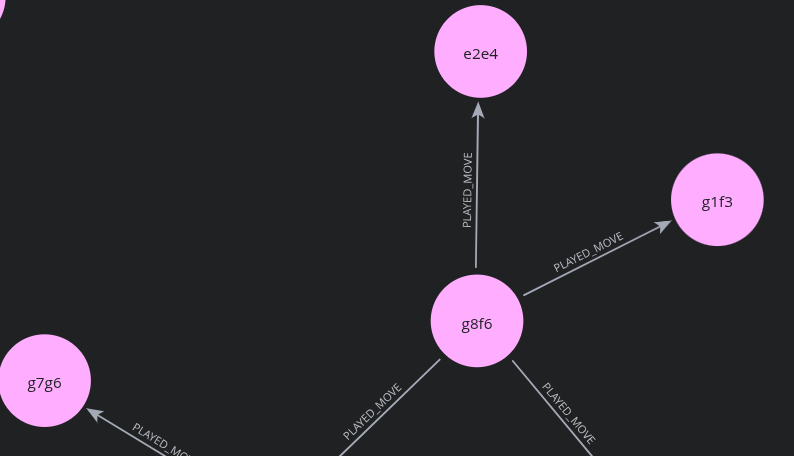

# NEO4J - Knowledge Graph 

Assume that **Neo4j** is installed and running locally [or you can download it on their official website]. There is `Community` and `Entreprise` edition. Because we are in demo, we can use the community edition.

 Neo4j is the world's leading native graph database and graph intelligence platform. It **stores and processes data as a network of connected nodes and relationships** rather than traditional tabular rows and columns.

---

## Graph

### Property Graph

A **Property Graph** (or Knowledge Graph) is a data structure that models information as a topological network of entities and the explicit connections between them. 

Unlike a relational database (PostgreSQL) that relies on rigid tables and computationally expensive `JOIN` operations across foreign keys.

A native graph database stores relationships as **index-free adjacency pointers** directly on disk—meaning traversing 10 moves ahead takes microseconds regardless of how many millions of games exist in the database.

### Graph Components in Neo4j

Every element in our Neo4j chess graph is built from four fundamental building blocks:

* **Nodes (Vertices):** The entities or states in the domain (drawn as circles). In our architecture, a node represents a board snapshot (`Position`), an opening classification (`Opening`), an endgame category (`EndgamePattern`), or a historical match (`Game`).

* **Labels:** Tags that group nodes by their role (e.g., `:Position`, `:Opening`, `:EndgamePattern`, `:Game`).

* **Relationships (Edges):** Directed, named arrows connecting two nodes (e.g., `(:Position)-[:PLAYED_MOVE]->(:Position)`). Relationships always have a start node, an end node, and a direction.

* **Properties (Key-Value Attributes):** Metadata stored inside both **Nodes** *and* **Relationships**. To eliminate any notation ambiguity (for instance, knowing immediately that `e4` or `e2e4` moved a `"Pawn"` while `Nf3` moved a `"Knight"`), we store `moved_piece`, `from_square`, `to_square`, and `is_capture` directly on the move relationship as well as `last_moved_piece` on the resulting `(:Position)` node.

### Why Use a Graph Database Here Instead of Only PostgreSQL ?

Chess is inherently a **directed state-transition graph**, not a flat list of text moves:

1. **Automatic Transposition Resolution:** In sequential PGN text or SQL tables, `1. d4 Nf6 2. c4 e6` and `1. c4 e6 2. d4 Nf6` look like two completely different move sequences. In Neo4j, both paths naturally converge into the **exact same `(:Position)` node** (`fen_norm`), uniting all your games and opening theory that pass through that board state.

2. **Multi-Hop Horizon Exploration:** When our Coach Agent or 3D UI explores 3–4 candidate branches 10 moves ahead (`20 plies`), Cypher pattern matching (`-[:PLAYED_MOVE*1..20]->`) traverses the decision tree natively without recursive SQL self-joins.

3. **Bridging Personal Habits to Theory:** Graph edges connect your personal `(:Position)` nodes directly to Hugging Face `(:Opening)` and `(:EndgamePattern)` hubs, allowing **Hermes-Agent** to spot the exact node where your move diverges from book theory.

---

## Connection Setup

You can stard neo4j with :

```bash
neo4j start
```

Open **Neo4j Browser** at `http://localhost:7474` and connect using your credentials:

```plaintext
Connect URL : bolt://127.0.0.1:7687
Username    : neo4j
Password    : your_neo4j_password
```

Add the following variables to your root `.env` file:

```ini
NEO4J_URI=bolt://127.0.0.1:7687
NEO4J_USER=neo4j
NEO4J_PASSWORD=your_neo4j_password
```

---

## Schema Constraints & Indexes

Unlike PostgreSQL, Neo4j does not require `CREATE TABLE` statements. Instead, run the following **Cypher** commands in Neo4j Browser to enforce node uniqueness and index fast graph traversals before running `neo4j_load.py`:

```cypher
CREATE CONSTRAINT position_fen_unique IF NOT EXISTS
FOR (p:Position) REQUIRE p.fen_norm IS UNIQUE;

CREATE CONSTRAINT opening_epd_unique IF NOT EXISTS
FOR (o:Opening) REQUIRE o.epd_norm IS UNIQUE;

CREATE CONSTRAINT endgame_type_unique IF NOT EXISTS
FOR (e:EndgamePattern) REQUIRE e.endgame_type IS UNIQUE;

CREATE CONSTRAINT game_id_unique IF NOT EXISTS
FOR (g:Game) REQUIRE g.game_id IS UNIQUE;

CREATE INDEX position_piece_count_idx IF NOT EXISTS
FOR (p:Position) ON (p.piece_count);

CREATE INDEX position_material_idx IF NOT EXISTS
FOR (p:Position) ON (p.material_sig);

CREATE INDEX opening_eco_idx IF NOT EXISTS
FOR (o:Opening) ON (o.eco_code);

CREATE INDEX game_type_idx IF NOT EXISTS
FOR (g:Game) ON (g.game_type);
```

---

## Graph Data Model Overview

### Node Properties

| Label | Key Properties |
| :--- | :--- |
| **`(:Position)`** | `fen_norm`, `turn_color`, `piece_count`, `material_sig`, `last_moved_piece` (*Pawn*, *Knight*, *Bishop*, *Rook*, *Queen*, *King*), `last_move_san`, `eval_cp`, `best_move_uci`, `visit_count` |
| **`(:Opening)`** | `epd_norm`, `opening_id`, `eco_volume`, `eco_code`, `opening_name`, `pgn_line`, `uci_line` |
| **`(:EndgamePattern)`** | `endgame_type` (*KNvK*, *KRvKP*, etc.), `piece_count`, `benchmark_positions`, `avg_player_elo`, `sample_fen`, `sample_human_move` |
| **`(:Game)`** | `game_id`, `game_type`, `played_date`, `user_color`, `user_elo`, `opponent_elo`, `user_outcome`, `result`, `eco_code`, `opening_name`, `total_plies` |

### Relationship Properties

| Relationship | Direction | Key Properties |
| :--- | :--- | :--- |
| **`[:PLAYED_MOVE]`** | `(:Position) -> (:Position)` | `uci_move`, `san_move`, **`moved_piece`** (*Pawn*, *Knight*, etc.), **`from_square`**, **`to_square`**, **`is_capture`**, `total_games`, `wins`, `losses`, `draws`, `win_rate_pct`, `avg_cp_loss`, `avg_clock_sec`, `best_move_uci` |
| **`[:THEORY_MOVE]`** | `(:Position) -> (:Position)` | `uci_move`, `san_move`, **`moved_piece`**, **`from_square`**, **`to_square`**, **`is_capture`**, `eco_code` |
| **`[:CLASSIFIED_AS]`** | `(:Position) -> (:Opening)` | Links book FEN positions to their ECO classification node |
| **`[:HAS_ENDGAME_TYPE]`** | `(:Position) -> (:EndgamePattern)` | `benchmark_move_uci`, `elo_tier`, `player_elo` |
| **`[:BLUNDERED_IN]`** | `(:Position) -> (:Game)` | `ply_number`, `played_san`, `played_uci`, **`moved_piece`**, `best_move_uci`, `cp_loss`, `clock_rem_sec` |

---

## Verification Queries in Neo4j Browser

After running `neo4j_load.py`, execute these Cypher queries in Neo4j Browser to explore the graph visually:

```cypher
// Count all loaded nodes by label
MATCH (n)
RETURN labels(n)[0] AS NodeType, count(n) AS TotalCount
ORDER BY TotalCount DESC;

// Visualize your Queen's Gambit Declined (D35) repertoire & book transpositions
MATCH path = (p1:Position)-[r:PLAYED_MOVE|THEORY_MOVE*1..4]->(p2:Position)-[:CLASSIFIED_AS]->(o:Opening)
WHERE o.eco_code STARTS WITH 'D3'
RETURN path
LIMIT 50;

// Visualize your Blunder Hotspots (avg_cp_loss >= 100) and the games they happened in
MATCH path = (p1:Position)-[r:PLAYED_MOVE]->(p2:Position)<-[:BLUNDERED_IN]-(g:Game)
WHERE r.avg_cp_loss >= 100
RETURN path
LIMIT 40;

// Visualize your Games transitioning into Endgame Pattern Hubs
MATCH path = (p:Position)-[:HAS_ENDGAME_TYPE]->(e:EndgamePattern)
WHERE p.visit_count >= 1
RETURN path
LIMIT 50;
```

## Result

