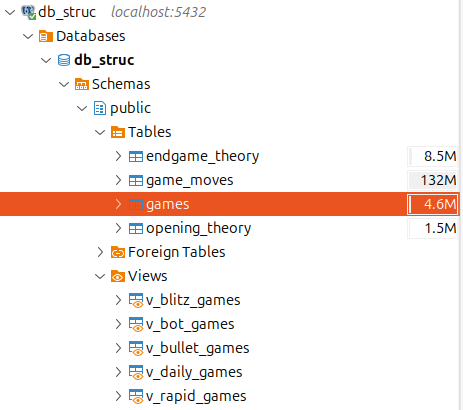

# DBEAVER - PostgreSQL

Assume that we have already establish the database connection in `DBEAVER`.

If not, follow these steps to create **USER** and the **DATABASE** on postgres [Assumed that you have **installed Postgresql** on your computer] :

```bash
sudo -u postgres psql

CREATE USER user_name WITH PASSWORD 'user_password';
CREATE DATABASE user_db OWNER user_name;
GRANT ALL PRIVILEGES ON DATABASE user_db TO user_name;
```

So, in `DBEAVER`, you can select the **Database** button to establish a **New connection** to the database that you've created above.

```plaintext
Database : user_db
username : user_name
password : user_password
```

## Initialization

I have preferred to split my pgn games into 5 files (`blitz`, `bullet`, `bot`, `daily`, `rapid`), all games share the exact same PGN header structure. 

But in postgres, store them in a single unified **`games`** table partitioned logically by a `game_type` ENUM and indexed for fast filtering. For convenient browsing in DBeaver, we also create dedicated **SQL Views** for each time control.

```sql
CREATE TABLE IF NOT EXISTS games (
    game_id          BIGSERIAL PRIMARY KEY,
    game_hash        VARCHAR(64) UNIQUE NOT NULL,
    game_type        game_category NOT NULL,
    
    -- PGN Header Fields (Mapped from [Event], [Site], [Date], etc.)
    event            VARCHAR(100) DEFAULT 'Live Chess',
    site             VARCHAR(50)  DEFAULT 'Chess.com',
    played_date      DATE NOT NULL,
    end_time_utc     TIME,
    round            VARCHAR(20)  DEFAULT '-',
    
    -- Players & Ratings
    white_username   VARCHAR(100) NOT NULL,
    black_username   VARCHAR(100) NOT NULL, 
    white_elo        INTEGER,
    black_elo        INTEGER,
    
    user_color       CHAR(5) CHECK (user_color IN ('white', 'black')),
    user_elo         INTEGER,
    opponent_elo     INTEGER,
    user_outcome     VARCHAR(10) CHECK (user_outcome IN ('win', 'loss', 'draw', 'other')),
    
    -- Result & Time Control
    result           game_result NOT NULL,
    time_control_raw VARCHAR(50) NOT NULL,
    base_time_sec    INTEGER,
    increment_sec    INTEGER DEFAULT 0, 
    termination      TEXT,
    
    -- Opening & Raw PGN
    eco_code         VARCHAR(10), 
    opening_name     TEXT,
    total_plies      INTEGER,
    pgn_moves_raw    TEXT NOT NULL,
    created_at       TIMESTAMPTZ DEFAULT NOW()
);
```

## Visualization

When finished to run the postgres_load.py, check the DBEAVER desktop to see if the loading is worked.

